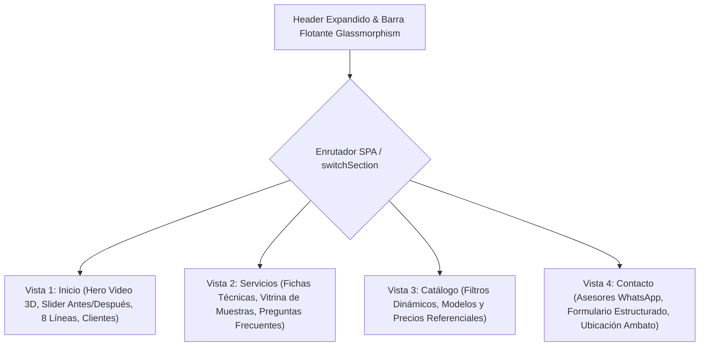

# Sistema de Diseño Visual & Microinteracciones — Plan $280 (CREAVID)

Documentación técnica y descriptiva del rediseño visual aplicado a la landing page del **Plan Básico $280** ([`demo-basica-280/index.html`](index.html)), basada en el estilo de referencia audiovisual de alta gama con foco en **animaciones de desenfoque progresivo (*blur reveals*)**.

---

## 1. Concepto y Filosofía Visual

El rediseño adopta una estética moderna de **arquitectura corporativa de alto impacto** inspirada en interfaces contemporáneas de productos premium (estilo Apple, Framer y estudios de arquitectura europeos):

* **Alto contraste temático:** Alternancia estratégica entre secciones en **modo oscuro profundo** (*Hero*, *Antes y Después*, *Banner CTA*, *Contacto* y *Footer*) y **modo claro minimalista** (*Qué fabricamos*, *Servicios Técnicos*), otorgando sofisticación sin sacrificar la legibilidad de especificaciones técnicas.
* **Superficies Glassmorphism:** Paneles de vidrio esmerilado con translucidez y desenfoque de fondo (`backdrop-filter: blur(20px)`), proporcionando profundidad de capas tridimensional.
* **Geometría de bordes suaves:** Bordes ultra redondeados (`rounded-3xl` de 24px a 32px) y botones estilo píldora (`rounded-full`).

---

## 2. Paleta de Colores y Tokens

| Token | Valor Hex / RGBA | Uso en la Interfaz |
| :--- | :--- | :--- |
| **Fondo Oscuro Primario** | `#0b0e13` / `#0a0d12` | Fondo general de la página, Hero y contenedor principal. |
| **Glassmorphism Dark** | `rgba(15, 20, 27, 0.82)` | Tarjeta flotante del Hero, cards de contacto y modales. |
| **Fondo Claro (Vitrina)** | `#ffffff` / `#f8fafc` | Bloques de "Qué fabricamos" y "Servicios". |
| **Verde Esmeralda (Acento)** | `#10b981` / `#059669` | Botones de WhatsApp, badges de precio, separador del slider y estados activos. |
| **Resplandor WhatsApp** | `rgba(16, 185, 129, 0.45)` | Sombra difusa y luminiscencia en botones de acción rápida (`.whatsapp-glow`). |
| **Bordes Oscuros** | `rgba(255, 255, 255, 0.10)` | Delimitaciones sutiles entre secciones y cards oscuras. |
| **Bordes Claros** | `#e2e8f0` (Slate-200) | Delimitaciones de fichas en fondo blanco. |
| **Tipografía Principal** | `#ffffff` / `#0f172a` | Texto de máximo contraste según la sección. |
| **Tipografía Secundaria** | `#94a3b8` / `#64748b` | Subtítulos, metadatos y descripciones auxiliares. |

---

## 3. Tipografía y Estructura Jerárquica

* **Fuente Principal:** `Plus Jakarta Sans` (Google Fonts).
* **Jerarquía de Pesos:**
  * **Black / Extrabold (800 - 900):** Titulares principales (`H1`, `H2`), números de línea y precios destacados.
  * **Bold (700):** Títulos de cards, enlaces de navegación y etiquetas de botones.
  * **Medium / Regular (400 - 500):** Textos de párrafos, fichas técnicas y formularios.
* **Badges y Kickers:** Píldoras compactas en mayúsculas con espaciado amplio (`tracking-widest` / `tracking-wider`, `text-[10px]` o `text-[11px]`) que orientan visualmente al usuario en cada bloque temático.

---

## 4. Motor de Animaciones Blur (*Blur Reveal Engine*)

La solicitud enfatiza las **animaciones de desenfoque al aparecer o alternar el contenido**. Se diseñó una arquitectura de 3 capas:

### A. Revelación Progresiva en Desplazamiento / Scroll (`.blur-reveal`)
Cada tarjeta, sección y bloque entra en escena detectada individualmente por un `IntersectionObserver`:
* **Estado Inicial:** `opacity: 0`, `filter: blur(20px)`, `transform: translateY(32px)`.
* **Estado Activo (`.revealed`):** `opacity: 1`, `filter: blur(0px)`, `transform: translateY(0)`.
* **Función de Tiempo:** `cubic-bezier(0.16, 1, 0.3, 1)` durante `0.8s` (curva de desaceleración tipo Apple / Framer).
* **Comportamiento por Desplazamiento:** Al abrir una sección, los elementos que están en la parte superior visible se enfocan suavemente, mientras que los elementos inferiores permanecen en reposo difuso hasta que el usuario se desplaza hacia ellos, enfocándose dinámicamente al entrar en pantalla.
* **Escalonamiento (*Stagger*):** Clases utilitarias (`delay-100`, `delay-200`, `delay-300`) para generar cascadas en columnas y cuadrículas.

### B. Transición de Filtro del Catálogo (`blurInStagger`)
Al presionar una categoría (*Ventanas, Puertas, Pasamanos, Fachadas, Baño*):
```css
@keyframes blurInStagger {
  0% {
    opacity: 0;
    filter: blur(16px);
    transform: translateY(16px) scale(0.97);
  }
  100% {
    opacity: 1;
    filter: blur(0px);
    transform: translateY(0) scale(1);
  }
}
```
Las tarjetas visibles se regeneran dinámicamente con un desfase matemático individual (`animationDelay = index * 70ms`).

### C. Desenfoque Cruzado Interactivo en "Qué Fabricamos" (`animate-blur-crossfade`)
Al seleccionar cualquiera de los 8 ítems técnicos de la lista izquierda:
```css
@keyframes blurCrossFade {
  0% {
    opacity: 0.3;
    filter: blur(14px);
  }
  100% {
    opacity: 1;
    filter: blur(0px);
  }
}
```
La tarjeta visual de la derecha sufre un reflow instantáneo de hardware en la GPU, pasando de desenfoque suave a nitidez completa con la nueva fotografía y ficha técnica.

---

## 5. Arquitectura por Secciones Independientes (SPA) & Componentes

El sitio web está dividido en **4 secciones independientes e intercambiables** con transición suave y revelación blur instantánea:



1. **Barra de Navegación con Indicador Activo Dinámico (`glass-nav`):**
   * Píldora central en Desktop y barra conmutadora flotante en Mobile (`sticky top-[76px] z-30`).
   * **Indicador de estado activo:** La pestaña correspondiente se resalta en color blanco sólido con tipografía negra ultra destacada (`bg-white text-slate-950 font-black shadow-md`), mientras las demás permanecen en gris translúcido interactivo.
   * **Transición Blur:** Al cambiar de sección, la vista saliente se oculta y la vista entrante se presenta con la animación fluida `.animate-blur-in`.
   * **Sincronización con URL:** Actualiza el hash (`#inicio`, `#servicios`, `#catalogo`, `#contacto`) y responde a los botones adelante/atrás del navegador.
2. **Hero con Video 3D (Reproducción Única) & Card Flotante:**
   * Ancho expandido (`mx-2 sm:mx-6`) calibrado al ancho de las tarjetas blancas corporativas.
   * Video de fondo (`banner_video.mp4` / `Video Project.mp4`) en resolución 1080p que inicia con la órbita del modelo 3D y transiciona hacia la fotografía arquitectónica real.
   * **Reproducción por visita:** Al ingresar o hacer clic en la pestaña **Inicio** (o en el logotipo), el video se reinicia desde el segundo cero (`currentTime = 0`) y se reproduce fluidamente hasta congelarse en el fotograma final.
   * Botón flotante *"Repetir video 3D"* para volver a reproducir la animación en cualquier momento sin recargar.
   * Card oscuro flotante con titular *"Obra terminada, con cumplimiento"*, proceso numerado de 4 etapas y accesos rápidos.
   * Botón circular inferior con flecha indicadora hacia la siguiente sección.
3. **Slider Interactivo "Antes y Después":**
   * Comparador interactivo arrastrable con cursor o táctil en móviles.
   * Revela la transición de la estructura de concreto/bloque en obra gris hacia la fachada terminada en cristal y alucubón del Hospital AMFAMED.
   * Manija central estilizada con flechas direccionales e insignias flotantes *"Antes"* y *"Después"*.
4. **Selector Interactivo de 8 Líneas ("Qué Fabricamos"):**
   * Panel izquierdo con 8 filas numeradas (01 Fachadas, 02 Alucubón, 03 Vidrio, 04 Ventanas, 05 Puertas, 06 Pasamanos, 07 Acero inoxidable, 08 Cortinas de baño).
   * Panel derecho reactivo: actualiza fotografía, número en marca de agua, categoría, especificaciones y botón de cotización directa.
5. **Carrusel Continuo de Clientes & Respaldo (Marquee Infinito):**
   * Cinta horizontal continua e infinita con marcas reales y corporativas (UTA, Medicity+, GAD Municipalidad de Ambato, SANFRA, Hospital AMFAMED, CIVALO, Condominio El Rosal, Plaza Mayor).
   * Animación CSS fluida a 60fps con pausa automática al pasar el cursor (`:hover`), máscara de degradado en ambos bordes laterales y tipografía gigante de respaldo `10+ Años`.
6. **Módulo de Muestras ("Vea el acabado antes de decidir"):**
   * Tarjeta oscura con muestras visuales de vidrio espejo y alucubón rojo para resolver objeciones antes del cierre de venta.
7. **Catálogo con Cotizador en 1 Toque:**
   * 7 modelos listos con fotografía, descripción, rango de precio (*Desde $60 / m²*, *Desde $120*, *Cotización por caso*) y botón que abre WhatsApp prellenando el nombre exacto del modelo.
8. **Acordeón FAQ Desplegable:**
   * 4 preguntas frecuentes con rotación suave de iconos `plus` a `minus`.
9. **Formulario Estructurado y Asesores WhatsApp:**
   * Sección *"Una solicitud, una proforma"* con 3 etapas visuales claras.
   * Formulario con captura de nombre, WhatsApp, tipo de servicio, medidas, ubicación y urgencia del proyecto.
   * Al enviar, codifica los parámetros y abre una conversación lista en WhatsApp.
   * Acceso directo independiente a **Asesor 1** y **Asesor 2**.
10. **Botón Flotante Persistente:**
    * Anclado en `fixed bottom-6 right-6` con halo luminiscente y pulso visual.

---

## 6. Rendimiento y Criterios Técnicos

* **Cero dependencias pesadas:** Construido 100% sobre HTML5 semántico, Tailwind CSS (vía CDN), Lucide Icons y JavaScript Vanilla nativo.
* **Aceleración por GPU:** Todas las animaciones utilizan propiedades transformables (`filter`, `opacity`, `transform`) junto con `will-change` para evitar re-layouts costosos en el hilo principal.
* **Responsive Total:** Probado y adaptado para smartphones (375px+), tablets, laptops y pantallas panorámicas (1440px+).
